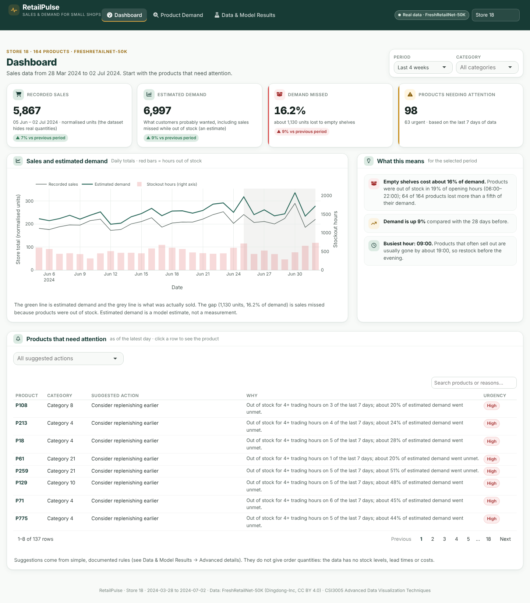
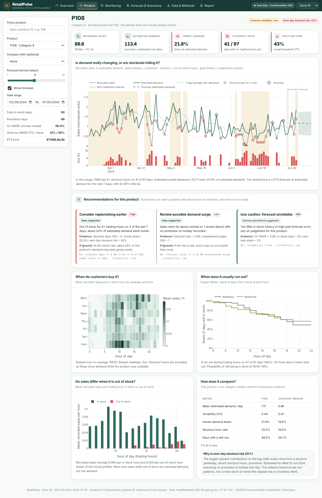
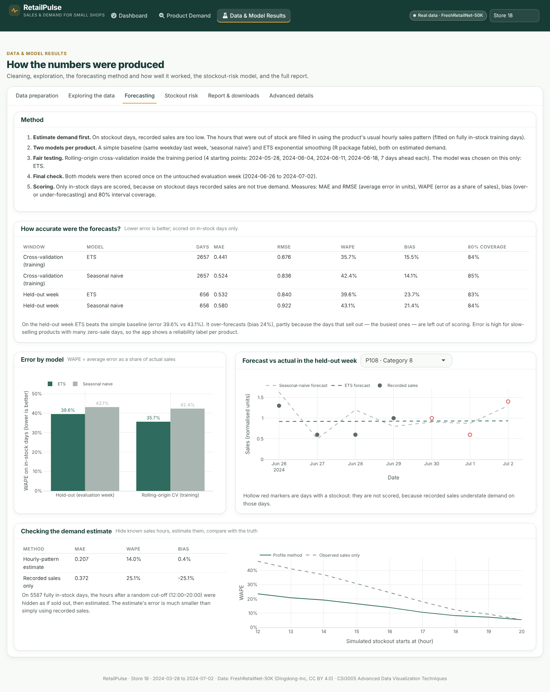
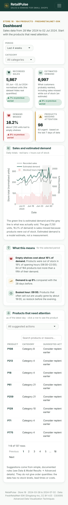

# RetailPulse — Demand Monitoring and Early Warning for Small Retailers

RetailPulse is an R analytics and decision-support web app for small perishable-goods retailers. It separates **recorded sales** from **estimated demand** on days when a product was out of stock. It then forecasts short-term demand against an honest baseline, flags unusual sales days with an explanation, scores next-day stockout risk, and turns all of this into a prioritised, explainable action queue.

Built for **CSI3005 Advanced Data Visualization Techniques** (VIT), Case Study-Based Lab Assessment.

> **Data status.** All numbers and screenshots come from the **real FreshRetailNet-50K data** (`train` and `eval` Parquet files). Three stores are shipped: **store 18** (default, 164 products), **235** (162) and **263** (161), all 2024-03-28 to 2024-07-02. The precomputed results (`outputs/`) are committed, so the deployed app shows real results without shipping the 115 MB dataset, which stays out of git. The navbar shows a "Real data" label; if the pipeline ever falls back to generated data, it shows "Synthetic demo data" and a banner instead.



---

## Contents
1. [What it does](#what-it-does) · [Feature audit](docs/AUDIT.md) · [Performance](#performance)
2. [Technology choice](#technology-choice)
3. [Architecture](#architecture)
4. [Data science workflow](#data-science-workflow)
5. [Evaluation results](#evaluation-results)
6. [Getting the dataset](#getting-the-dataset)
7. [Run locally](#run-locally)
8. [Tests](#tests)
9. [Deploy on Render](#deploy-on-render)
10. [Configuration](#configuration)
11. [Decision rules](#decision-rules)
12. [Limitations](#limitations)
13. [Project structure](#project-structure)

---

## What it does

Three analysis pages, simplified after a [feature-by-feature audit](docs/AUDIT.md) of the earlier six-page version, plus an **Inventory** page for the user's own store data.

| Page | Question it answers | What is on it |
| --- | --- | --- |
| **Dashboard** | What needs attention first? | Period (last 7 days … all data) and category filters; 4 clickable KPI cards (recorded sales, estimated demand, demand missed, products needing attention) with change vs the previous period, each opening the analysis behind it; sales vs estimated demand chart; "What this means" in plain language; one searchable **Products that need attention** list (filter by suggested action, click a row to open the product) |
| **Product Demand** | Is this product's demand changing, or are stockouts hiding it? What next? | Product search; history window; 7- or 14-day forecast; 4 product KPIs incl. tomorrow's stockout chance; sales / estimated demand / forecast chart with promotions, stockouts and unusual days; **What the forecast says** (plain-language reading, 80% range, how much to trust it); suggested actions with evidence; collapsible **More about this product** (weekday × hour pattern, sell-out curve, category comparison, model details) |
| **Inventory** | How long will my own stock last? | **Your store data, kept separate from the research data.** Editable product catalogue (SKU, name, category, price, stock, reorder level, lead time, expiry, optional link to a research product): add, edit, delete with confirmation, search, sort, filter by status or category, clickable status cards; **CSV import** with a downloadable template, column and row validation (missing IDs, invalid or negative numbers, duplicate SKUs, bad dates, unknown research links), a preview, a choice to skip or replace existing SKUs and a download of the rows to fix; **CSV export**; optional, clearly labelled **sample records**; **stockout simulator** (stock on hand, expected sales per day, demand change, lead time, extra delivery delay, safety stock, 7/14/30-day horizon) comparing your assumptions with a hypothetical scenario, with a chart and CSV export. A linked research product adds its historical stockout chance, suggested action and (optionally) its weekday pattern, used only as relative weights. |
| **Data & Model Results** | Can the results be trusted? | Tabs: **Data preparation** (quality cards, raw vs cleaned, checks and treatments, missing values, before/after demand, features) · **Exploring the data** (store weekday × hour, in- vs out-of-stock sales, categories, volatility) · **Forecasting** (method, CV and held-out accuracy, error by model, forecast vs actual, demand-estimate validation) · **Stockout risk** (metrics vs baseline, confusion matrix, odds ratios) · **CSV Downloads** (5 result tables) · **Advanced details** (anomaly heatmap and threshold sensitivity, decision rules, validation scatter, calibration, promotion associations, hourly replay check, dataset and limitations) |

Removed from the interface after the audit: the hourly replay player and alert explorer, the scenario and weight sliders, the adjustable anomaly threshold, product comparison overlays, the top-products chart, duplicate alert panels and the custom date pickers. The calculations behind them are kept where they feed other results (for example, replay alerts are summarised under Advanced details and downloadable).

**Data labels.** The app keeps five kinds of data apart and labels them: *historical research data* (FreshRetailNet-50K, normalised units, anonymous product IDs; CC BY 4.0 attribution under Advanced details → Dataset and limitations), *your store data* (Inventory page), *sample records* (badge "Sample record"; invented for demonstration, not real prices or stock), *forecasts and model predictions*, and *hypothetical scenario outputs* (simulator). Research values are never converted into the user's item counts, and no order quantities or delivery dates are suggested.

**Where the catalogue is saved.** In the visitor's own browser (`localStorage`, key `retailpulse.catalogue.v1`, see `app/www/inventory.js`). It survives page reloads, server restarts and Render redeploys, needs no database or account, and is not shared with other visitors. Clearing browser data removes it, so the page offers **Export CSV** as a backup and **Import CSV** to move it to another device. If storage is blocked (for example, private browsing), the page says so and changes last only until the page is closed.

The R Markdown report (`report/report.Rmd`) is still knitted at build time for the assessment, but it is no longer offered as a download in the app.

**Design system.** Deep forest green `#173B35` (navigation, headings, primary buttons), warm white `#F8FAF8` (page), white (cards, tables, charts), muted gold `#D9A441` (small highlights, selected states), sage `#DCEBE3` (positive / low risk), alert red `#DC5555` (critical only) and amber `#C98A12` (warnings). KPI accents turn red or amber only when a value crosses a documented threshold.

| Product Demand | Data & Model Results | Mobile |
| --- | --- | --- |
|  |  |  |

---

## Technology choice

**Everything is in R**: the pipeline in R with tidyverse, `fable` and `survival`, the dashboard in **Shiny** with `bslib`, `plotly` and `reactable`, and the report in **R Markdown** with `ggplot2`. It ships as **one Docker web service on Render**.

- The faculty brief requires visualizations "implemented in R using appropriate R visualization libraries".
- R has mature tools for exactly these methods (ETS via `fable`, survival curves, logistic regression).
- One service: no API contract and no database. All model results are read-only artifacts computed before deployment; the app only re-runs the cheap rule engine.
- R 4.4 and every package come from **conda-forge**, pinned in `environment.yml`, so the Render build does not compile packages or depend on CRAN mirrors.

---

## Architecture

```
          before deployment (locally, or Docker build with RP_REBUILD=true)            run time (Render web service)
 ┌──────────────────────────────────────────────────────────────────┐      ┌────────────────────────────────────┐
 │ data/raw/train.parquet, eval.parquet (FreshRetailNet-50K)        │      │ Rscript app/run.R → 0.0.0.0:$PORT  │
 │            ▼                                                     │      │ startup: read gzip bundle, build   │
 │ pipeline/run_pipeline.R per store: validate → clean → latent     │ ───▶ │  + cache page HTML, precompute     │
 │   demand → features → forecasts → anomalies → risk → sell-out →  │      │  rules; 3 Shiny pages (plotly)     │
 │   replay → decision rules → outputs/ + app_bundle.rds (R/bundle.R)│      │ per visit: cached outputs reused   │
 │ scripts/knit_reports.R → R Markdown report per store             │      │ /reports/report_<id>.html          │
 └──────────────────────────────────────────────────────────────────┘      └────────────────────────────────────┘
```

Model fitting never happens inside a web request.

---

## Data science workflow

1. **Load.** One store is chosen automatically (many products, stockout-hour rate between 5% and 35%) or set with `RP_STORE_ID`. Both splits are loaded: `train` (90 days) and `eval` (the next 7 days).
2. **Validate and clean.** Checks for schema, duplicate product-days, hourly lists of the wrong length, hourly-sum vs daily-total mismatches, negative values, discounts out of range, `stock_hour6_22_cnt` vs a recount, missing calendar days, and missing values (weather imputed with the store median). Each check is counted and shown in the app.
3. **Stockout flags.** Out-of-stock hours are counted only between 06:00 and 21:59, matching `stock_hour6_22_cnt`. Overnight flags may mean "closed" and are excluded.
4. **Latent (estimated) demand.** Hourly profiles are fitted on **training** fully in-stock days, separately for weekday and weekend and shrunk towards the product profile. On a stockout day, demand level = in-stock sales ÷ in-stock profile share, and missing hours are filled with level × share. If under 25% of the profile was in stock, a trailing 28-day in-stock median is used instead.
   *Validation:* hide hours from a random cut-off (12:00–20:00) on fully in-stock days, estimate the total with a leave-one-out profile, and compare with the truth.
5. **Features (leakage-safe).** Weekday, weekend, promotion depth, lag 1 and 7, rolling 7- and 28-day means, recent stockout rate and hours, yesterday's event, expanding event frequency, and demand ratio. Every rolling or lag value uses only earlier days (unit-tested).
6. **Forecasting.** Seasonal naive (same weekday last week) vs ETS (`fable`) on estimated demand. Rolling-origin CV with 4 origins × 7 days inside training, then a final test on the untouched eval week. The model is chosen on CV only. Scores use **in-stock days only**: MAE, RMSE, WAPE, bias and 80% interval coverage.
7. **Anomalies.** Robust z of recorded sales after dividing by a weekday factor estimated from the previous 56 days, against the median of the previous 28 in-stock days. Flag when |z| ≥ 3 (adjustable). Each flag is labelled *Stockout*, *Promotion*, *Holiday*, *Possibly heavy rain* or *Unexplained*.
8. **Stockout risk.** Logistic regression for "4+ trading hours out of stock tomorrow", using only information up to yesterday plus tomorrow's planned promotion, holiday and weekend flags. Chronological fit, validation and test, with the threshold chosen on validation. Compared with a historical-frequency baseline using AUC, Brier score, precision, recall, F1 and a confusion matrix.
9. **Sell-out timing.** First out-of-stock trading hour per day, censored at 22:00, with Kaplan–Meier curves by weekday and weekend.
10. **Replay.** Eval-week hourly data. Expected values come from the training-only forecast × the hourly profile, and alerts at hour *h* use only data up to *h*.
11. **Decisions.** Transparent rules (below) produce an action, reason, evidence, urgency, reliability and the rule that fired. Priority = urgency × (1 + w₁·unmet share + w₂·risk + w₃·unusual activity).

---

## Evaluation results

Produced by `pipeline/run_pipeline.R` on the **real FreshRetailNet-50K data, store 18** (164 products; train 2024-03-28 to 06-25, eval 06-26 to 07-02; runtime about 5 minutes). Sales are normalised units, so errors are in those units.

**Data quality:** 15,908 product-days, 0 duplicates, 0 hourly-sum mismatches. Stockouts cover **20.6%** of trading hours; an estimated **17.8%** of demand went unmet.

**Latent-demand validation** (5,587 hidden-hours tests):

| Method | MAE | WAPE | Bias |
| --- | --- | --- | --- |
| Hourly-profile estimate | 0.207 | 14.0% | +0.4% |
| Observed sales only | 0.372 | 25.1% | −25.1% |

**Forecasting** (in-stock days only):

| Window | Model | Days | MAE | RMSE | WAPE | Bias | 80% coverage |
| --- | --- | --- | --- | --- | --- | --- | --- |
| Rolling-origin CV | ETS | 2,657 | 0.441 | 0.676 | 35.7% | +15.5% | 84% |
| Rolling-origin CV | Seasonal naive | 2,657 | 0.524 | 0.836 | 42.4% | +14.1% | 85% |
| Hold-out eval week | ETS | 656 | 0.532 | 0.840 | 39.6% | +23.7% | 83% |
| Hold-out eval week | Seasonal naive | 656 | 0.580 | 0.922 | 43.1% | +21.4% | 84% |

ETS was chosen on CV and also beats seasonal naive on the hold-out week. Both over-forecast the eval week (positive bias), which is worth stating honestly.

**Stockout risk** (eval-week test, n = 1,148, event rate 34.5%, threshold 0.27 chosen on validation): logistic AUC 0.654, Brier 0.211, F1 0.529 (precision 43%, recall 68%), against a frequency baseline with AUC 0.540 and F1 0.494. This is a modest improvement: useful for ranking, not a precise predictor.

**Anomalies:** 742 flagged product-days at |z| ≥ 3, 127 unexplained. There is no ground truth, so no accuracy is claimed.

**Other shipped stores** (same pipeline, same settings):

| Store | Products | Stockout-hour rate | Unmet demand | Hold-out WAPE ETS / naive | Risk AUC logistic / baseline |
| --- | --- | --- | --- | --- | --- |
| 18 | 164 | 20.6% | 17.8% | 39.6% / 43.1% | 0.654 / 0.540 |
| 235 | 162 | 19.2% | 17.7% | 31.1% / 39.6% | 0.658 / 0.549 |
| 263 | 161 | 19.9% | 15.9% | 34.4% / 41.9% | 0.665 / 0.570 |

**Recommendations, store 18** (one product can get several): 93 replenish earlier, 27 review surge, 6 plan for lower demand, 3 investigate drop, 80 use caution (low forecast reliability), 27 maintain. **Replay alerts:** 720.

---

## Getting the dataset

FreshRetailNet-50K: <https://huggingface.co/datasets/Dingdong-Inc/FreshRetailNet-50K> (Dingdong-Inc, **CC BY 4.0**; Wang et al., 2025, arXiv:2505.16319).

**Option A: automatic** (default). With `RP_DATA_MODE=auto` and no local files, the pipeline asks the Hugging Face datasets-server API for the Parquet file list and downloads the `train` and `eval` files into `data/raw/`. This happens during the Render build, where Hugging Face is reachable.

**Option B: manual.** Download the Parquet files from the dataset page ("Files and versions", or the auto-converted Parquet files) and place them in `data/raw/`. File names must contain `train` or `eval`, for example `train-00.parquet` and `eval-00.parquet`. Then run the pipeline.

**What this repository ships.** `train.parquet` is 106 MB, above GitHub's 100 MB file limit, so the raw files are git-ignored. Instead the **precomputed real-data results in `outputs/`** are committed, and the Docker build uses them directly (`RP_REBUILD=false`, the default). To recompute during the build, set `RP_REBUILD=true`; the pipeline then uses `data/raw/` or downloads from Hugging Face. Locally, put the two files in `data/raw/` and run the pipeline.

`RP_DATA_MODE=synthetic` forces demo mode. Synthetic data is never presented as real: the manifest records `"mode": "synthetic"`, and every page shows a banner.

---

## Run locally

Requirements: R 4.4 with the packages in `environment.yml`. The easiest route is conda or micromamba:

```bash
micromamba create -n retailpulse -f environment.yml
micromamba activate retailpulse

Rscript pipeline/run_pipeline.R                                   # ~5 min per store
Rscript scripts/knit_reports.R                                    # one report per shipped store
PORT=3838 Rscript app/run.R                                       # open http://localhost:3838
```

With a plain R installation instead: `install.packages(c("dplyr","tidyr","lubridate","arrow","ggplot2","scales","patchwork","slider","jsonlite","tsibble","fable","fabletools","feasts","survival","shiny","bslib","plotly","reactable","htmltools","testthat","rmarkdown","knitr","purrr","readr","tibble","stringr"))`. Versions may then differ from the pinned ones.

---

## Tests

```bash
Rscript tests/run_tests.R                      # R unit + integration tests (needs outputs/)

# browser tests (Playwright) against a running app
pip install playwright pytest && playwright install chromium
PORT=3838 Rscript app/run.R &
RP_URL=http://127.0.0.1:3838 pytest tests/ui -q
```

**Last verified run (development environment, real store-18 data):**

- `tests/run_tests.R`: **234 expectations passed, 0 failed.** Includes `test-inventory.R`: template and sample validate; missing columns are a file error; row errors for missing SKU/name, negative or non-whole stock, bad price, lead time and date, duplicate SKUs (in the file and against the catalogue, case-insensitive) and unknown research links; flexible column names; merging never adds invalid rows and never overwrites unless asked; status and expiry rules; simulator arithmetic (days left, safety-stock day, stock at delivery, sales at risk, zero demand, zero and negative stock, delivery beyond the horizon); demand multiplier and weekday pattern; browser-storage round trip and corrupt input.
- Earlier R checks: Schema, duplicates, wrong-length and mismatch handling; trading-hour stockout counting; leakage-free lags and rolling means; latent-demand invariants and validation; forecast metrics and windows; anomaly baselines; classification metrics and chronological split; every decision rule; sell-out censoring; replay alerts not using future hours; output consistency; every chart builder with empty and real inputs; store registry; the three-page app object; lean gzip bundles for every store; and the faster rule engine reproducing the pipeline's recommendations exactly.
- `tests/ui/test_inventory.py` (Playwright): **16 passed.** Empty state; sample records saved to the browser; add with validation messages; edit and link to P108; status card filters the table; delete needs confirmation (Keep it / Delete); template and export contents; import preview (5 rows: 2 valid, 3 rejected, 1 existing SKU skipped, existing record not overwritten) and the rows-to-fix download; wrong file rejected; simulator numbers (10 items at 4/day = 2.5 days, then +50% demand and +2 days delay = 1.7 days and "before a delivery … would arrive"), its CSV, zero and negative demand, reset; linked weekday pattern and research box opening P108; the Product page shows the linked item and jumps back to the simulator; dashboard KPI cards open Stockout risk and Exploring the data; the catalogue survives a reload; clear all; no horizontal scroll at 390 px; no JavaScript errors. Separately checked: the catalogue is still there after a **full server restart** (same browser profile, new R process).
- `tests/ui/test_ui.py` (Playwright): **14 passed.** The four pages exist; real-data label; dashboard cards, chart and attention list; period and category filters change the KPIs (and restore them); action filter; an attention row opens the right product; changing product updates the page; 14-day forecast shows the "only 7 days tested" warning; history window; "More about this product" renders only when opened; every Data & Model Results tab and Advanced panel; CSV Downloads tab without report link and all five CSVs (byte-identical to the previous version); store switch; no horizontal scroll at 390 px; no JavaScript errors.
- **Not verified here:** a real `docker build` (Docker Hub is blocked in the development environment) and the Render deployment itself; check the Render log as described below.

---

## Deploy on Render

**Service:** one **Web Service** with the **Docker** runtime (`render.yaml`, service `retailpulse`). No database, worker or disk.

1. The repository is `https://github.com/Vaishh-ux/Retail_Pulse` (branch `main`).
2. Existing Blueprint: open it in Render and click **Manual sync** (or, on the service, **Manual Deploy → Deploy latest commit**). New: **New → Blueprint**, paste the repository URL, **Apply**.
3. The build installs R from conda-forge, uses the committed results in `outputs/`, and knits one report per store. Start command `Rscript app/run.R` binds to `0.0.0.0:$PORT`; health check `/favicon.svg`.
4. **Verify in the log:** `Using precomputed outputs: "mode": "real"`, then `RetailPulse warm-up done`, `first page pre-rendered`, `Listening on http://0.0.0.0:10000`, then **Your service is live**. The page should show **Real data · FreshRetailNet-50K** and **Store 18**.

**Free instance:** it sleeps after about 15 minutes without visitors; the next visit waits for the container to restart (Render says 50 s or more) plus the app's own startup (measured below). Open the link a minute before a demo. A Starter or Standard instance does not sleep and has more CPU.

| Symptom | Likely cause | Fix |
| --- | --- | --- |
| "No open HTTP ports detected" | Instance too slow to answer during startup | Already mitigated (page pre-rendered at startup); redeploy, or use a larger instance |
| "RetailPulse results not found" | `outputs/` missing from the image | Make sure `outputs/` is pushed |
| Out-of-memory restart | Many simultaneous users on 512 MB | Measured ~290 MB per process; upgrade the instance if needed |

---

## Performance

Measured with Playwright on the development machine, at full CPU and with the R process limited to **10% of one CPU** (`cpulimit -l 10`), which approximates Render's free instance (about 0.1 CPU). Render's own cold-start time (restarting a sleeping container) could not be measured from here and comes on top of the startup figure.

| Measure | Before (6 pages): full CPU | Before: 10% CPU | After (3 pages): full CPU | After: 10% CPU |
| --- | --- | --- | --- | --- |
| Startup until the server listens | 4.7 s | 37.3 s | 4.3 s | 33.6 s |
| First visit: dashboard ready | 4.5 s | 21.2 s | 2.4 s | **6.1 s** |
| Later visit: dashboard ready | 2.7 s | 7.1 s | 2.1 s | **4.4 s** |
| Open product page (first / later visit) | 1.8 / 1.5 s | 11.0 / 6.8 s | 1.3 / 0.8 s | 7.4 / **1.4 s** |
| Change product (first / later visit) | 1.0 / 0.9 s | 2.4 / 3.3 s | 0.6 / 0.2 s | 2.2 / **0.2 s** |
| Open Data & Model Results (first / later visit) | 0.6 / 1.0 s (Data & Methods) | 1.8 / 2.8 s | 0.8 / 0.9 s | 1.8 / 4.6 s |
| Memory (resident) | 382 MB | 391 MB | 288 MB | 294 MB |

**What was slow and what changed**
1. *Results file compressed with xz*: 0.61 s to read per store at full speed → gzip, 0.07 s.
2. *Full hourly table (11.7 MB of 19.3 MB per store) loaded for one chart* → not loaded by the app; per-store bundle now 5.8 MB in memory.
3. *Rule engine built a table per recommendation*: 0.76 s → 0.12 s, identical output (tested).
4. *Six page servers per visitor, a replay timer and two scenario recalculations* → three pages; Product and Data & Model Results start only when first opened; panels under "More about this product" and "Advanced details" render only when expanded.
5. *Every visitor re-computed the same results and charts* → anomalies, recommendations and every store-level output are cached across visitors (`shiny::bindCache`, 40 MB cap); keys include the store, period, category and product, so a different selection is never served a stale result. The caches live in memory and are rebuilt whenever the app restarts with new outputs.
6. *First page built on the first request (9 s at 10% CPU)* → page HTML pre-rendered when the app starts.

**Remaining bottleneck:** startup on a 0.1-CPU instance (about 34 s here), mostly loading R packages and compiling the custom Bootstrap theme once (13 s at 10% CPU). It happens once per container start, before the first visitor is served, and adds to Render's own wake-up time after the free instance has slept. Timings at 10% CPU vary by about ±1 s between runs. A precompiled default theme would save about 6 s but would change the approved look, so it was not used.

## Configuration

See `.env.example`. Key settings: `RP_DATA_MODE` (`auto`, `real` or `synthetic`), `RP_STORE_ID`, `RP_ALLOW_DOWNLOAD`, `RP_STOCKOUT_DAY_HOURS` (8), `RP_RISK_EVENT_HOURS` (4), `RP_ANOMALY_Z` (3), `RP_SEED` and `PORT`.

---

## Decision rules

These thresholds are documented design choices, not proven decision boundaries.

| Rule | Action | Fires when |
| --- | --- | --- |
| R1 | Consider replenishing earlier | 3+ of the last 7 days had 4+ stockout hours, **or** (next-day risk ≥ model threshold **and** unmet share ≥ 10%) |
| R2 | Investigate unexplained sales drop | An *Unexplained* drop anomaly in the last 7 days |
| R3 | Review possible demand surge | Forecast for the next 7 days ≥ 125% of the last 7 days' estimated demand, **or** an *Unexplained* surge |
| R4 | Plan for lower demand | Forecast ratio ≤ 80% and reliability not Low |
| R5 | Use caution: forecast unreliable | CV WAPE > 45%, fewer than 20 fully in-stock days, or more than 50% zero-sale days |
| R6 | Maintain current approach | No other rule fired |

No rule outputs order quantities, reorder dates or money: the dataset has no inventory, lead time or cost data, and sales are normalised.

---

## Limitations

- Sales are **globally normalised** by an undisclosed factor, so everything is in normalised units.
- There is **no inventory, price, cost, lead time or shelf-life** information. Recommendations are directional only.
- `hours_stock_status = 1` is documented as out of stock; overnight flags may mean closed. Only 06:00–21:59 is analysed.
- Estimated demand assumes a stable hourly profile. Its error is measured, and it is always labelled as an estimate.
- 90 days of training data gives weekly patterns but no yearly seasonality. Horizons beyond 7 days are not evaluated (the app warns about this).
- Stores belong to one large operator, so they are a proxy for an independent shop.
- Promotion effects are observational, not causal.
- The monitoring page is a **historical replay**, not a live feed.

**Future work:** censored-regression demand models, hierarchical forecasts across categories, real point-of-sale streaming, and an inventory field to enable reorder-quantity optimisation.

---

## Project structure

```
R/                 analysis functions (config, data_io, synth, prepare, latent, forecast, anomaly, risk, sellout, monitor, scenario, decide, bundle)
pipeline/          run_pipeline.R - runs everything, writes outputs/
app/               app.R, run.R (production entry), R/ (data, theme, charts, 3 page modules: dashboard, product, results), www/
scripts/           knit_reports.R (R Markdown per store), make_bundles.R (rebuild app bundles from outputs/)
report/            report.Rmd - academic report (ggplot2, interpretation, code)
tests/testthat/    R unit and integration tests;  tests/ui/ Playwright browser tests and screenshot script
data/raw/          put FreshRetailNet-50K Parquet files here (git-ignored)
outputs/           precomputed real-data results (committed): default store + stores/<id>/
docs/screenshots/  screenshots of the running app (real data, store 18);  docs/AUDIT.md feature audit
environment.yml    pinned R environment (conda-forge)
Dockerfile, render.yaml, .env.example, .gitignore, .dockerignore
```

**Citation:** Wang, Y., Gu, J., Long, L., Li, X., Shen, L., Fu, Z., Zhou, X. and Jiang, X. (2025). *FreshRetailNet-50K: A Stockout-Annotated Censored Demand Dataset for Latent Demand Recovery and Forecasting in Fresh Retail.* arXiv:2505.16319.
