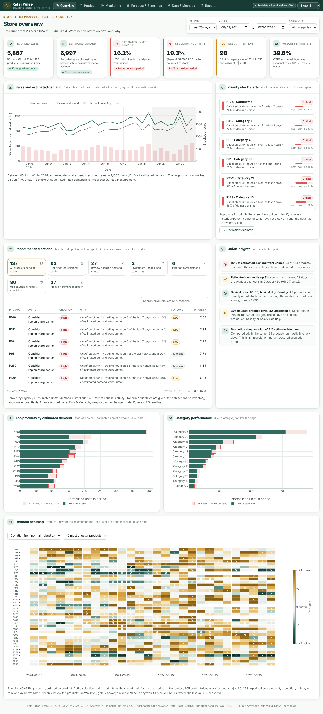
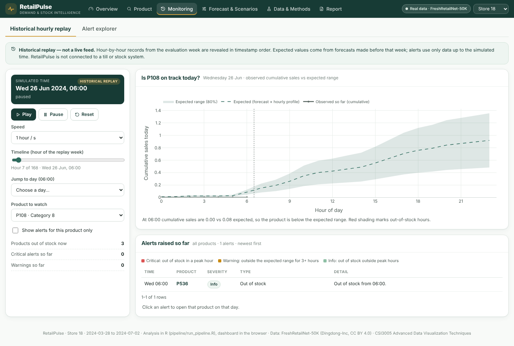
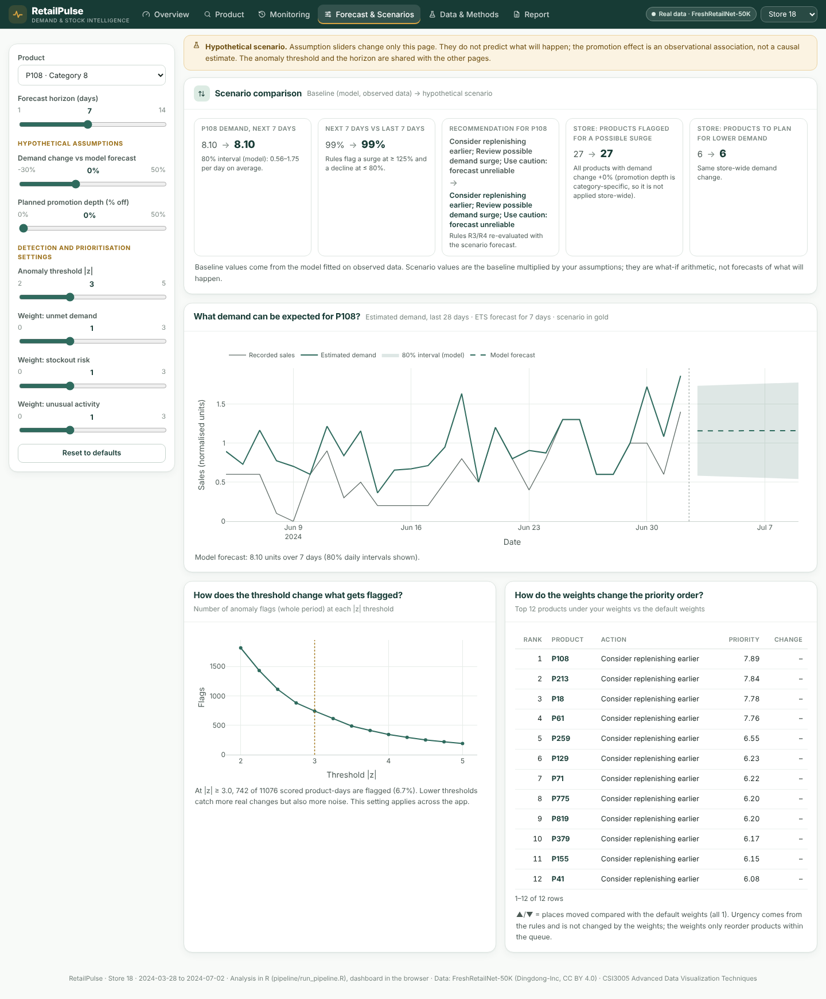
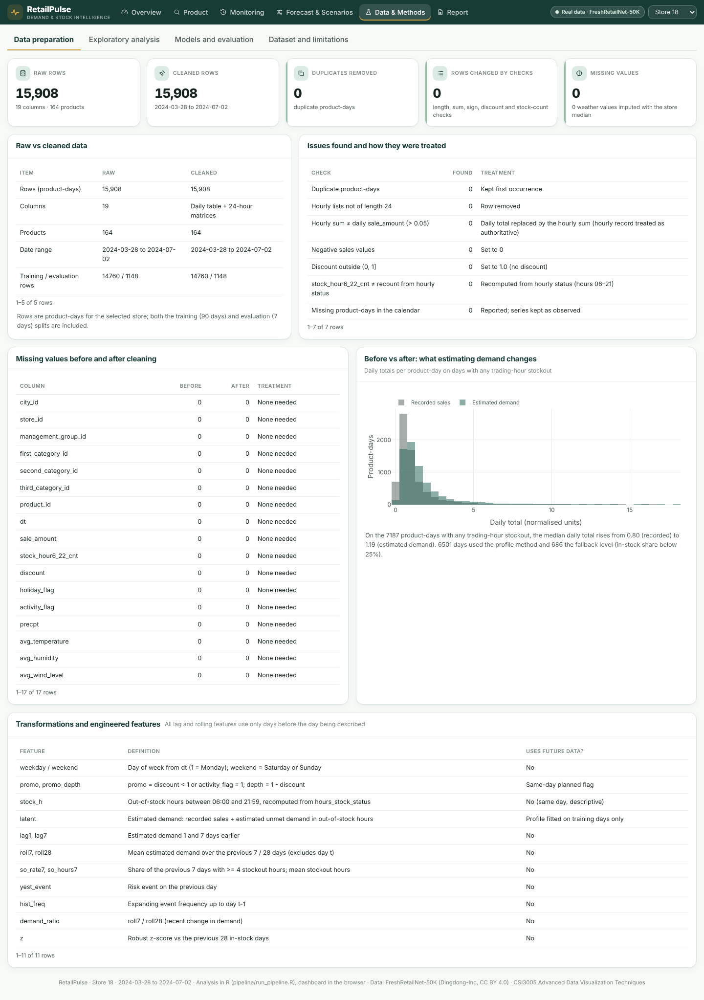
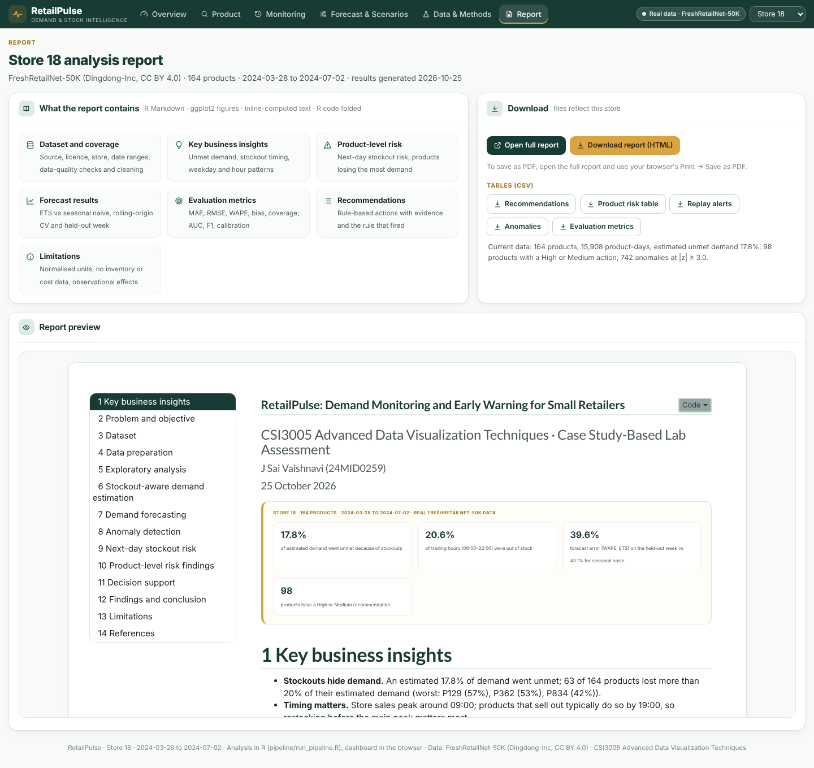
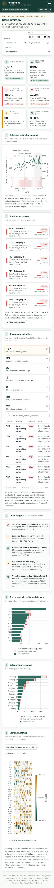

# RetailPulse — Demand Monitoring and Early Warning for Small Retailers

RetailPulse is an R analytics and decision-support web app for small perishable-goods retailers. It separates **recorded sales** from **estimated demand** on days when a product was out of stock. It then forecasts short-term demand against an honest baseline, flags unusual sales days with an explanation, scores next-day stockout risk, and turns all of this into a prioritised, explainable action queue.

Built for **CSI3005 Advanced Data Visualization Techniques** (VIT), Case Study-Based Lab Assessment.

> **Data status.** All numbers and screenshots in this README come from the **real FreshRetailNet-50K data** (`train` and `eval` Parquet files). Three stores are shipped: **store 18** (default, 164 products), **235** (162) and **263** (161), all 2024-03-28 to 2024-07-02. The precomputed results (`outputs/`, about 15 MB) are committed, so the deployed app shows real results without shipping the 115 MB dataset, which stays out of git. The navbar shows a "Real data" label; if the pipeline ever falls back to generated data, it shows "Synthetic demo data" and a banner instead. The hourly monitoring page is a **historical replay** of eval-week data, not a live feed.



---

## Contents
1. [What it does](#what-it-does)
2. [Technology choice](#technology-choice)
3. [Architecture](#architecture)
4. [Data science workflow](#data-science-workflow)
5. [Evaluation results](#evaluation-results)
6. [Getting the dataset](#getting-the-dataset)
7. [Run locally](#run-locally)
8. [Tests](#tests)
9. [Deploy on Render](#deploy-on-render)
10. [Configuration](#configuration)
11. [Decision rules](#decision-rules)
12. [Limitations](#limitations)
13. [Project structure](#project-structure)

---

## What it does

| Page | Question it answers | Main components |
| --- | --- | --- |
| **Overview** | What needs attention first? | Store selector (navbar), period and category filters; 6 KPI cards with change vs the previous period; sales vs estimated demand trend; priority stock alerts; recommended-action tiles that filter a searchable action queue; quick insights computed from the data; top products and category performance (click to drill in); product × day heatmap with three modes (deviation, demand, stockout hours) |
| **Product** | Is demand really changing, or are stockouts hiding it? | Product search, comparison product overlaid on the trend, 5 product KPIs; recorded sales vs estimated demand with stockout strip, promotions, anomalies and forecast (1–14 days, 80% interval); recommendations with evidence and rule; weekday × hour heatmap; sell-out curve (Kaplan–Meier); in-stock vs out-of-stock sales; category comparison; risk explanation |
| **Monitoring** | Is today on track? | **Historical hourly replay** (clearly labelled, not live) with play, pause, reset, speed, a timeline slider and jump-to-day; product to watch and "this product only" alert filter; alerts raised only from data up to the simulated time (click to open the product); alert explorer with type, severity, product and date filters, search and a detail view |
| **Forecast & Scenarios** | What if demand changes or a promotion runs? | Horizon slider; hypothetical demand change; promotion-depth slider (observational association with 95% CI); **baseline → scenario comparison** that re-runs the surge/decline rules for the product and the whole store; anomaly-threshold sensitivity (shared across pages); priority-weight reordering |
| **Data & Methods** | Can the results be trusted? | Data-quality summary cards, raw vs cleaned data, issues and treatments, missing values before and after, before/after demand distribution, feature dictionary, EDA, latent-demand validation, forecast comparison, actual vs forecast, risk metrics, confusion matrix, calibration, odds ratios, rules, dataset and limitations |

| **Report** | What should I share? | Preview of the R Markdown report for the selected store, open or download it (HTML; print to PDF from the browser), and CSV downloads of recommendations, product risk, replay alerts, anomalies and evaluation metrics |

The **R Markdown report** (ggplot2 figures, inline-computed interpretation, R code) is knitted per store at build time and contains an executive summary, key business insights, product-level risk findings, forecast and evaluation results, recommendations and limitations.

**Design system.** Deep forest green `#173B35` (navigation, headings, primary buttons), warm white `#F8FAF8` (page), white (cards, tables, charts), muted gold `#D9A441` (small highlights, selected states, scenario line), sage `#DCEBE3` (positive / low risk), alert red `#DC5555` (critical stockouts only) and amber `#C98A12` (medium warnings). KPI accents turn red or amber only when the value crosses a documented threshold. Fonts: Plus Jakarta Sans (headings) and Inter (text).

| Product | Monitoring (replay) | Forecast & Scenarios |
| --- | --- | --- |
|  |  |  |
| **Data & Methods** | **Report** | **Mobile** |
|  |  |  |

---

## Technology choice

**Analysis in R, dashboard in the browser.**

- **R does all the analysis**: the pipeline in R with tidyverse, `fable` and `survival` (`pipeline/run_pipeline.R`), and the academic report in **R Markdown** with `ggplot2` (`report/report.Rmd`).
- **The deployed dashboard is a static website** (`site/`: HTML, CSS, JavaScript and Plotly.js) that reads the R results as JSON. It is published as a **free Render Static Site**: no server, nothing to wake up, opens in about a second.
- The only calculations done in the browser are the cheap, transparent steps that react to the user's settings: anomaly classification at the chosen threshold, the decision rules R1–R6, priority weights and scenario multipliers. They are line-by-line ports of `R/anomaly.R`, `R/decide.R` and `R/scenario.R`, and `tests/static/parity.test.js` checks that the browser gives **exactly the same recommendations and anomaly counts as R** for every shipped store.
- **The Shiny version is kept** (`app/`, `Dockerfile`): the same six pages written in R/Shiny with `bslib`, `plotly` and `reactable`. It is fully tested, but on Render's free 0.1-CPU instance it was too slow (sleeping server plus R rendering per visitor), which is why the static build is the default deployment. Run it locally with `PORT=3838 Rscript app/run.R`, or deploy it with the Dockerfile on a paid instance.

Why not a server at all: nothing in the dashboard is user-generated or needs to persist, and every model result is a deterministic output of the R pipeline. Precomputing them removes the database, the API and the cold starts.

---

## Architecture

```
  R (locally, before deployment)                                       browser (Render Static Site, free)
 ┌──────────────────────────────────────────────────────────────┐    ┌───────────────────────────────────┐
 │ data/raw/train.parquet, eval.parquet  (FreshRetailNet-50K)   │    │ site/index.html + js/ + Plotly.js │
 │            ▼                                                 │    │  6 pages: Overview, Product,      │
 │ pipeline/run_pipeline.R  per store: validate → clean →       │    │  Monitoring (historical replay),  │
 │   latent demand → features → forecasts → anomalies → risk →  │    │  Forecast & Scenarios, Data &     │
 │   sell-out → replay → scenarios → decision rules  → outputs/ │──▶ │  Methods, Report                  │
 │ scripts/knit_reports.R   → R Markdown report per store       │    │  re-runs only the rules R1–R6,    │
 │ scripts/export_static.R  → site/data/store_<id>.json,        │    │  anomaly threshold and scenario   │
 │                            site/reports/report_<id>.html     │    │  multipliers (same logic as R)    │
 └──────────────────────────────────────────────────────────────┘    └───────────────────────────────────┘
```

Rebuild everything after changing the analysis: `Rscript pipeline/run_pipeline.R` (with `RP_STORE_ID` / `RP_OUTPUT_DIR` for extra stores), then `sh scripts/build_site.sh`.

---

## Data science workflow

1. **Load.** One store is chosen automatically (many products, stockout-hour rate between 5% and 35%) or set with `RP_STORE_ID`. Both splits are loaded: `train` (90 days) and `eval` (the next 7 days).
2. **Validate and clean.** Checks for schema, duplicate product-days, hourly lists of the wrong length, hourly-sum vs daily-total mismatches, negative values, discounts out of range, `stock_hour6_22_cnt` vs a recount, missing calendar days, and missing values (weather imputed with the store median). Each check is counted and shown in the app.
3. **Stockout flags.** Out-of-stock hours are counted only between 06:00 and 21:59, matching `stock_hour6_22_cnt`. Overnight flags may mean "closed" and are excluded.
4. **Latent (estimated) demand.** Hourly profiles are fitted on **training** fully in-stock days, separately for weekday and weekend and shrunk towards the product profile. On a stockout day, demand level = in-stock sales ÷ in-stock profile share, and missing hours are filled with level × share. If under 25% of the profile was in stock, a trailing 28-day in-stock median is used instead.
   *Validation:* hide hours from a random cut-off (12:00–20:00) on fully in-stock days, estimate the total with a leave-one-out profile, and compare with the truth.
5. **Features (leakage-safe).** Weekday, weekend, promotion depth, lag 1 and 7, rolling 7- and 28-day means, recent stockout rate and hours, yesterday's event, expanding event frequency, and demand ratio. Every rolling or lag value uses only earlier days (unit-tested).
6. **Forecasting.** Seasonal naive (same weekday last week) vs ETS (`fable`) on estimated demand. Rolling-origin CV with 4 origins × 7 days inside training, then a final test on the untouched eval week. The model is chosen on CV only. Scores use **in-stock days only**: MAE, RMSE, WAPE, bias and 80% interval coverage.
7. **Anomalies.** Robust z of recorded sales after dividing by a weekday factor estimated from the previous 56 days, against the median of the previous 28 in-stock days. Flag when |z| ≥ 3 (adjustable). Each flag is labelled *Stockout*, *Promotion*, *Holiday*, *Possibly heavy rain* or *Unexplained*.
8. **Stockout risk.** Logistic regression for "4+ trading hours out of stock tomorrow", using only information up to yesterday plus tomorrow's planned promotion, holiday and weekend flags. Chronological fit, validation and test, with the threshold chosen on validation. Compared with a historical-frequency baseline using AUC, Brier score, precision, recall, F1 and a confusion matrix.
9. **Sell-out timing.** First out-of-stock trading hour per day, censored at 22:00, with Kaplan–Meier curves by weekday and weekend.
10. **Replay.** Eval-week hourly data. Expected values come from the training-only forecast × the hourly profile, and alerts at hour *h* use only data up to *h*.
11. **Decisions.** Transparent rules (below) produce an action, reason, evidence, urgency, reliability and the rule that fired. Priority = urgency × (1 + w₁·unmet share + w₂·risk + w₃·unusual activity).

---

## Evaluation results

Produced by `pipeline/run_pipeline.R` on the **real FreshRetailNet-50K data, store 18** (164 products; train 2024-03-28 to 06-25, eval 06-26 to 07-02; runtime about 5 minutes). Sales are normalised units, so errors are in those units.

**Data quality:** 15,908 product-days, 0 duplicates, 0 hourly-sum mismatches. Stockouts cover **20.6%** of trading hours; an estimated **17.8%** of demand went unmet.

**Latent-demand validation** (5,587 hidden-hours tests):

| Method | MAE | WAPE | Bias |
| --- | --- | --- | --- |
| Hourly-profile estimate | 0.207 | 14.0% | +0.4% |
| Observed sales only | 0.372 | 25.1% | −25.1% |

**Forecasting** (in-stock days only):

| Window | Model | Days | MAE | RMSE | WAPE | Bias | 80% coverage |
| --- | --- | --- | --- | --- | --- | --- | --- |
| Rolling-origin CV | ETS | 2,657 | 0.441 | 0.676 | 35.7% | +15.5% | 84% |
| Rolling-origin CV | Seasonal naive | 2,657 | 0.524 | 0.836 | 42.4% | +14.1% | 85% |
| Hold-out eval week | ETS | 656 | 0.532 | 0.840 | 39.6% | +23.7% | 83% |
| Hold-out eval week | Seasonal naive | 656 | 0.580 | 0.922 | 43.1% | +21.4% | 84% |

ETS was chosen on CV and also beats seasonal naive on the hold-out week. Both over-forecast the eval week (positive bias), which is worth stating honestly.

**Stockout risk** (eval-week test, n = 1,148, event rate 34.5%, threshold 0.27 chosen on validation): logistic AUC 0.654, Brier 0.211, F1 0.529 (precision 43%, recall 68%), against a frequency baseline with AUC 0.540 and F1 0.494. This is a modest improvement: useful for ranking, not a precise predictor.

**Anomalies:** 742 flagged product-days at |z| ≥ 3, 127 unexplained. There is no ground truth, so no accuracy is claimed.

**Other shipped stores** (same pipeline, same settings):

| Store | Products | Stockout-hour rate | Unmet demand | Hold-out WAPE ETS / naive | Risk AUC logistic / baseline |
| --- | --- | --- | --- | --- | --- |
| 18 | 164 | 20.6% | 17.8% | 39.6% / 43.1% | 0.654 / 0.540 |
| 235 | 162 | 19.2% | 17.7% | 31.1% / 39.6% | 0.658 / 0.549 |
| 263 | 161 | 19.9% | 15.9% | 34.4% / 41.9% | 0.665 / 0.570 |

**Recommendations, store 18** (one product can get several): 93 replenish earlier, 27 review surge, 6 plan for lower demand, 3 investigate drop, 80 use caution (low forecast reliability), 27 maintain. **Replay alerts:** 720.

---

## Getting the dataset

FreshRetailNet-50K: <https://huggingface.co/datasets/Dingdong-Inc/FreshRetailNet-50K> (Dingdong-Inc, **CC BY 4.0**; Wang et al., 2025, arXiv:2505.16319).

**Option A: automatic** (default). With `RP_DATA_MODE=auto` and no local files, the pipeline asks the Hugging Face datasets-server API for the Parquet file list and downloads the `train` and `eval` files into `data/raw/`. This happens during the Render build, where Hugging Face is reachable.

**Option B: manual.** Download the Parquet files from the dataset page ("Files and versions", or the auto-converted Parquet files) and place them in `data/raw/`. File names must contain `train` or `eval`, for example `train-00.parquet` and `eval-00.parquet`. Then run the pipeline.

**What this repository ships.** `train.parquet` is 106 MB, above GitHub's 100 MB file limit, so the raw files are git-ignored. Instead the **precomputed real-data results in `outputs/`** are committed, and the Docker build uses them directly (`RP_REBUILD=false`, the default). To recompute during the build, set `RP_REBUILD=true`; the pipeline then uses `data/raw/` or downloads from Hugging Face. Locally, put the two files in `data/raw/` and run the pipeline.

`RP_DATA_MODE=synthetic` forces demo mode. Synthetic data is never presented as real: the manifest records `"mode": "synthetic"`, and every page shows a banner.

---

## Run locally

Requirements: R 4.4 with the packages in `environment.yml`. The easiest route is conda or micromamba:

```bash
micromamba create -n retailpulse -f environment.yml
micromamba activate retailpulse

Rscript pipeline/run_pipeline.R                                   # ~5 min per store
Rscript scripts/knit_reports.R                                    # one report per shipped store
PORT=3838 Rscript app/run.R                                       # open http://localhost:3838
```

With a plain R installation instead: `install.packages(c("dplyr","tidyr","lubridate","arrow","ggplot2","scales","patchwork","slider","jsonlite","tsibble","fable","fabletools","feasts","survival","shiny","bslib","plotly","reactable","htmltools","testthat","rmarkdown","knitr","purrr","readr","tibble","stringr"))`. Versions may then differ from the pinned ones.

---

## Tests

```bash
Rscript tests/run_tests.R                      # R unit + integration tests (needs outputs/ for app checks)

# static dashboard: JS rules must equal R, then browser tests
node tests/static/parity.test.js
(cd site && python3 -m http.server 8080 &) ; RP_URL=http://127.0.0.1:8080 pytest tests/static -q

# browser tests (Playwright) against a running app
pip install playwright pytest && playwright install chromium
PORT=3838 Rscript app/run.R &
RP_URL=http://127.0.0.1:3838 pytest tests/ui -q
```

**Last verified run (development environment):**
All results below are on the real store-18 data.

- `tests/run_tests.R`: **133 expectations passed, 0 failed, 0 skipped.** Covers schema; duplicate, wrong-length and mismatch handling; trading-hour stockout counting; leakage-free lags and rolling means (including that changing today's value does not change today's features); latent-demand invariants and exact recovery of a known profile; validation beating observed-only; forecast metric formulas and empty-input handling; forecast output shape and the eval window being after training; anomaly baseline independence from the day's own value; stockout-labelled anomalies; classification metrics; chronological risk split; every decision rule (including the surge reason text); weights reordering without changing urgency; sell-out censoring; replay alerts not using future hours; output consistency; every chart builder with empty and real inputs (including the new top-product, category and heatmap modes); the store registry (all shipped stores load, unknown store falls back, real and synthetic stores are never mixed); and the scenario demand change feeding the surge/decline rules.
- `tests/static/parity.test.js`: **identical** recommendations (action, urgency, reliability, priority, rule, order) and anomaly counts to R for stores 18, 235 and 263; the scenario growth scales the forecast ratio exactly.
- `tests/static` (Playwright, static site): **19 passed.** Same interactions as the Shiny tests below, plus: the page re-computes R's results at default settings, table search and sorting, product search, the weight sliders reorder the queue, all five CSV downloads, the phone menu, and no horizontal scroll at 390 px. The Overview's KPIs appear about 1 s after opening the page.
- `tests/ui` (Playwright, Shiny version): **16 passed.** Overview cards and real-data label; period and category filters change the KPIs (and restore them); action tiles filter the queue; all three heatmap modes render; a stock alert, a queue row and a heatmap cell each open the right product (and date); product comparison adds a line to the trend; horizon warning beyond 7 days; replay play, pause, reset and jump-to-day; alert filters and detail view; the scenario comparison recalculates (forecast × 1.4 for +40%) and draws the scenario line; the threshold is shared across pages; all Methods tabs render; report link returns 200 and the HTML and CSV downloads contain data; switching store reloads with `?store=<id>`; no horizontal scroll at 390 px; no JavaScript errors.
- **Production start-up replica.** The Dockerfile steps were reproduced in a clean copy with a fresh environment created from `environment.yml`: pipeline, report, then `Rscript app/run.R` on `0.0.0.0:$PORT`. Results: `/` returns 200, `/report.html` returns 200, and the 9 UI tests pass. Memory was 287 MB idle and 368 MB after a full UI session on demo data, and about 400 MB after the UI tests on the real data. With the redesigned UI and two stores visited, the clean copy used about 450 MB after all 16 UI tests; `RP_STORE_CACHE` (default 2) caps how many stores stay in memory.
- **Build-step replica.** The Dockerfile's build step (precomputed outputs → `scripts/knit_reports.R`) was run in a copy without the raw Parquet files.
- **Not verified:** a real `docker build` (Docker Hub was blocked in the development environment), the Hugging Face download (`RP_REBUILD=true` path), and a live Render deployment.

---

## Deploy on Render

**Default: free Static Site** (no server, does not sleep, no card needed).

1. The repository is on GitHub: `https://github.com/Vaishh-ux/Retail_Pulse` (branch `main`). `site/` is committed, pre-built from the R results.
2. In Render: **New → Blueprint**, paste the repository URL (or pick it if your GitHub account is connected), and **Apply**. `render.yaml` creates one **Static Site** called `retailpulse-site` that publishes `./site`.
   *Manually:* **New → Static Site**, choose the repository, **Build command** `echo ok`, **Publish directory** `site`.
3. When it shows **Live**, open the `.onrender.com` URL. The navbar should read **Real data · FreshRetailNet-50K** and **Store 18**.
4. After changing the analysis: re-run the R pipeline and `sh scripts/build_site.sh`, commit `site/`, and push. Render redeploys the site (or click **Manual Deploy** for a public-URL Blueprint).

**Shiny version on Render (optional, paid instance recommended).** The `Dockerfile` still builds the R/Shiny app (R from conda-forge, `CMD ["Rscript","app/run.R"]` on `0.0.0.0:$PORT`, health check `/favicon.svg`). It deployed and went **Live** on Render's free instance, but pages were slow there (about 0.1 CPU, and the instance sleeps after ~15 minutes). To use it, create a **Web Service** with runtime **Docker** from this repository, on a Starter or Standard instance.

| Symptom | Likely cause | Fix |
| --- | --- | --- |
| Static site shows "Could not load data/index.json" | `site/data/` not pushed | Run `sh scripts/build_site.sh`, commit `site/`, push |
| Page loads but a store is missing | Store not exported | Run the pipeline for it, then `scripts/build_site.sh` |
| Shiny service: "No open HTTP ports detected" | Instance too slow to answer the first request | Use the static site, or a larger instance |

---

## Configuration

See `.env.example`. Key settings: `RP_DATA_MODE` (`auto`, `real` or `synthetic`), `RP_STORE_ID`, `RP_ALLOW_DOWNLOAD`, `RP_STOCKOUT_DAY_HOURS` (8), `RP_RISK_EVENT_HOURS` (4), `RP_ANOMALY_Z` (3), `RP_SEED` and `PORT`.

---

## Decision rules

These thresholds are documented design choices, not proven decision boundaries.

| Rule | Action | Fires when |
| --- | --- | --- |
| R1 | Consider replenishing earlier | 3+ of the last 7 days had 4+ stockout hours, **or** (next-day risk ≥ model threshold **and** unmet share ≥ 10%) |
| R2 | Investigate unexplained sales drop | An *Unexplained* drop anomaly in the last 7 days |
| R3 | Review possible demand surge | Forecast for the next 7 days ≥ 125% of the last 7 days' estimated demand, **or** an *Unexplained* surge |
| R4 | Plan for lower demand | Forecast ratio ≤ 80% and reliability not Low |
| R5 | Use caution: forecast unreliable | CV WAPE > 45%, fewer than 20 fully in-stock days, or more than 50% zero-sale days |
| R6 | Maintain current approach | No other rule fired |

No rule outputs order quantities, reorder dates or money: the dataset has no inventory, lead time or cost data, and sales are normalised.

---

## Limitations

- Sales are **globally normalised** by an undisclosed factor, so everything is in normalised units.
- There is **no inventory, price, cost, lead time or shelf-life** information. Recommendations are directional only.
- `hours_stock_status = 1` is documented as out of stock; overnight flags may mean closed. Only 06:00–21:59 is analysed.
- Estimated demand assumes a stable hourly profile. Its error is measured, and it is always labelled as an estimate.
- 90 days of training data gives weekly patterns but no yearly seasonality. Horizons beyond 7 days are not evaluated (the app warns about this).
- Stores belong to one large operator, so they are a proxy for an independent shop.
- Promotion effects are observational, not causal.
- The monitoring page is a **historical replay**, not a live feed.

**Future work:** censored-regression demand models, hierarchical forecasts across categories, real point-of-sale streaming, and an inventory field to enable reorder-quantity optimisation.

---

## Project structure

```
R/                 analysis functions (config, data_io, synth, prepare, latent, forecast, anomaly, risk, sellout, monitor, scenario, decide)
pipeline/          run_pipeline.R - runs everything, writes outputs/
site/              static dashboard (deployed): index.html, css/, js/ (core = R rules ported, ui, charts, 6 pages), vendor/plotly, data/*.json, reports/
app/               Shiny version: app.R, run.R, R/ (data, theme, charts, 6 page modules), www/
scripts/           knit_reports.R (R Markdown per store), export_static.R (R results -> site/data), build_site.sh
report/            report.Rmd - academic report (ggplot2, interpretation, code)
tests/testthat/    R unit and integration tests;  tests/static/ parity + Playwright tests for site/;  tests/ui/ Playwright tests for the Shiny app
data/raw/          put FreshRetailNet-50K Parquet files here (git-ignored)
outputs/           precomputed real-data results (committed): default store + stores/<id>/
docs/screenshots/  screenshots of the running app (real data, store 18)
environment.yml    pinned R environment (conda-forge)
Dockerfile, render.yaml, .env.example, .gitignore, .dockerignore
```

**Citation:** Wang, Y., Gu, J., Long, L., Li, X., Shen, L., Fu, Z., Zhou, X. and Jiang, X. (2025). *FreshRetailNet-50K: A Stockout-Annotated Censored Demand Dataset for Latent Demand Recovery and Forecasting in Fresh Retail.* arXiv:2505.16319.
